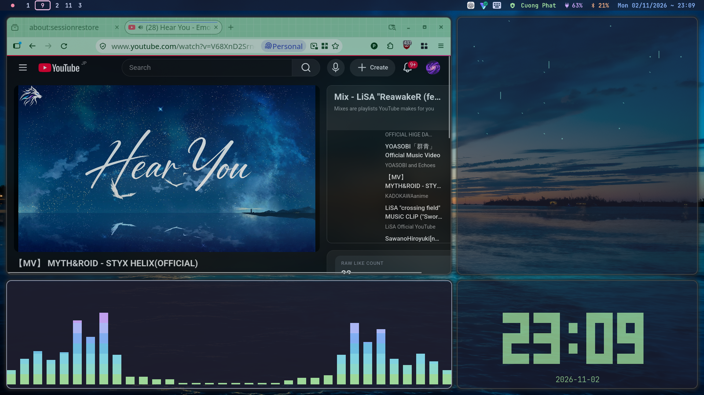
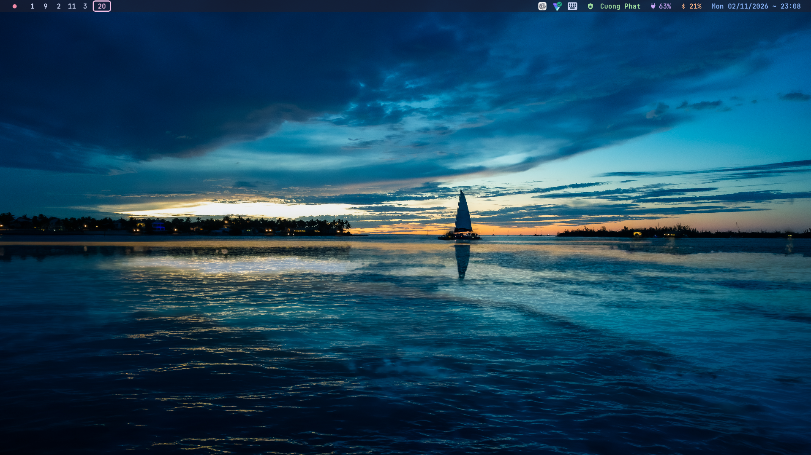
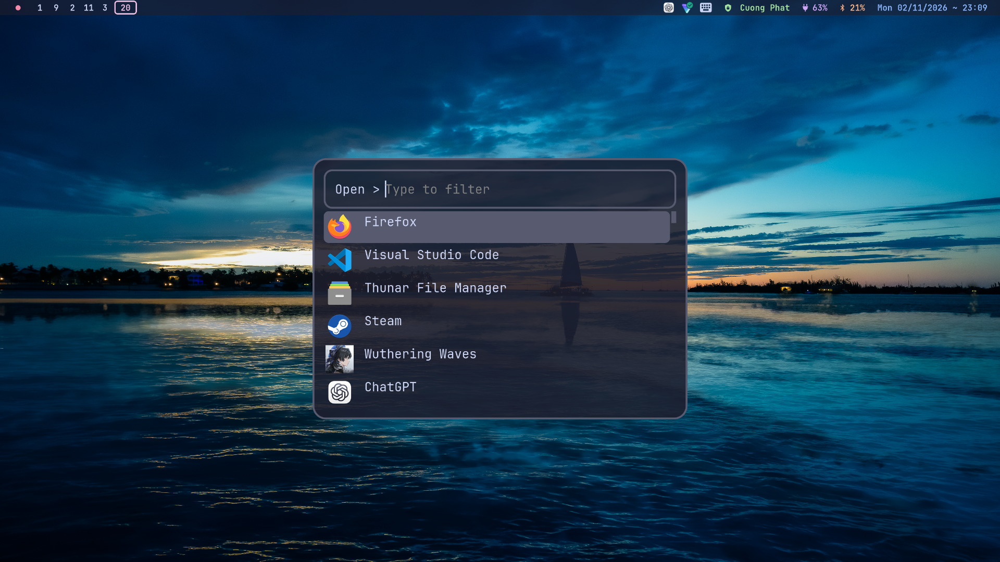
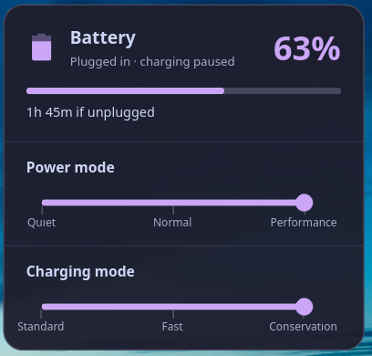
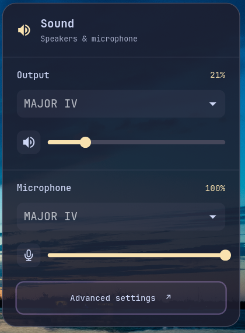
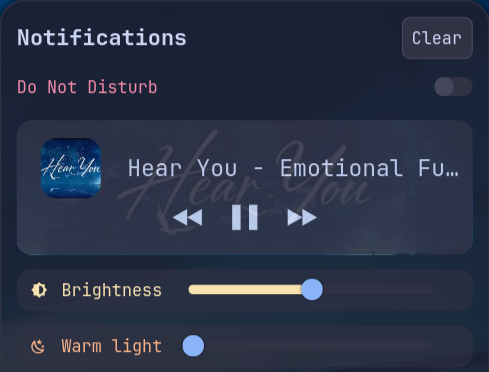
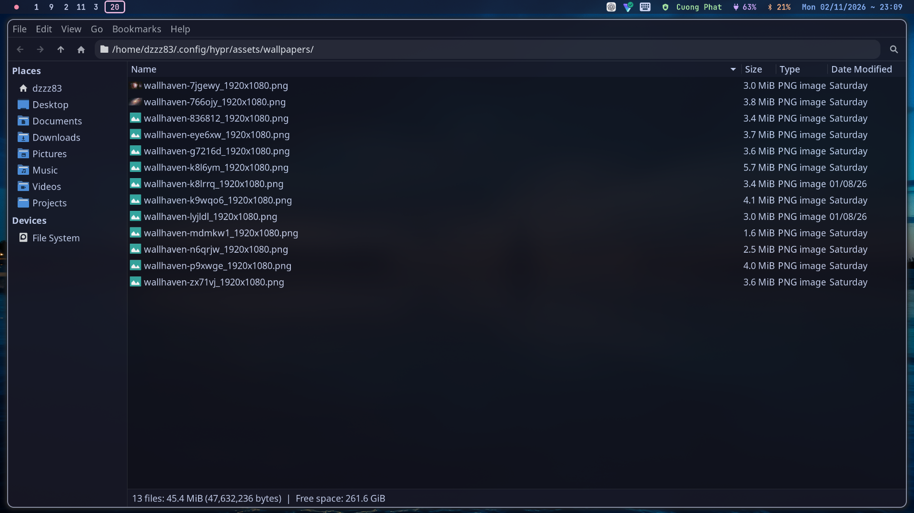
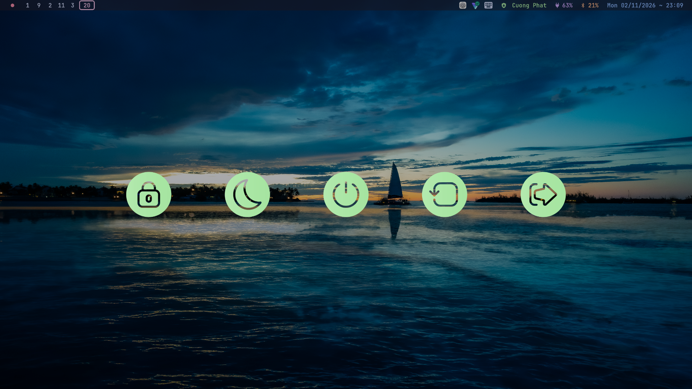

# Hyprland Dotfiles

My Hyprland CachyOS desktop.
Hyprland with Lua config, Catppuccin Mocha, translucent panels, and a workspace for music, Cava, rain, and a clock.



## Overview

- Smooth workspace slides and an Alt-held workspace preview.
- Waybar with matching Wi-Fi, Bluetooth, sound, and battery popups.
- SwayNC notifications with an artwork-led media card, brightness, and warm-light controls.
- One toolbar for screenshots, annotation, and screen recording.
- Ghostty, Fish, Rofi, Thunar, and a green power menu.
- Configs, themes, icons, wallpapers, and modified sources in one checkout.

| Part | Choice |
| --- | --- |
| System | CachyOS / Arch Linux |
| Compositor | Hyprland 0.57.1, Lua configuration |
| Terminal / shell | Ghostty / Fish |
| Bar / launcher / notifications | Waybar / Rofi / SwayNC |
| Files | Thunar with Papirus-Dark icons |
| Theme / cursor | Catppuccin Mocha / Breeze, size 24 |

## Screenshots

Captured from this setup. Click an image to view it at full size.

| Desktop | Launcher |
| --- | --- |
|  |  |

| Battery and charging | Sound | Notification controls |
| --- | --- | --- |
|  |  |  |

| Thunar | Power menu |
| --- | --- |
|  |  |

## Requirements

[requirements.txt](requirements.txt) lists system packages, build tools, and optional input packages. It is an Arch package list, not a pip file.

- Tested with **Hyprland 0.57.1** and matching installed headers.
- Hyprspace and HyprCapture must be rebuilt when Hyprland changes.
- HyprCapture also needs rebuilding after relevant Qt upgrades.
- Lenovo charging controls require compatible firmware and `legion_cli`.
- `btop` and `rofi-emoji` are needed for their optional shortcuts.

Package names and availability depend on your enabled repositories.
Other distributions and a second physical machine have not been tested.

## Installation

### 1. Clone

Keep the checkout outside `~/.config/hypr`, since deployment backs up that
location and links it to the checkout. This also works when the machine already
has a Hyprland configuration.

```bash
git clone https://github.com/Dzzz83/hyprland-dots.git ~/hyprland-dots
cd ~/hyprland-dots
```

### 2. Install packages

Review `requirements.txt`, removing optional packages you do not need.
On CachyOS/Arch, install the listed packages with a full system upgrade:

```bash
sudo pacman -Syu --needed $(grep -vE '^#|^$' requirements.txt)
```

If a package is unavailable, check your repositories or AUR before continuing.
After an upgrade, log out of the old Hyprland session before building. Build
from a TTY or from a session running the same Hyprland version as the installed
package.

### 3. Build

```bash
install/build-native.sh all
```

This builds the workspace plugin, capture tool, and Wi-Fi/audio panels.
The first build needs network access to download the Rust dependencies.
For later rebuilds, unload the affected plugin first; never replace a loaded library.

### 4. Deploy

Start with the generic profile on a new machine:

```bash
python3 install/deploy.py --profile generic --dry-run
python3 install/deploy.py --profile generic
```

The deployer backs up existing files, then links the checkout at `~/.config/hypr`.
Backups go to `~/.local/state/hypr-dots-backups/<timestamp>`.
Run deployment inside a desktop session so `xfconf-query` can apply the Thunar
preferences. From a TTY, add `--skip-thunar`, then rerun without it after login.

| Option | Use |
| --- | --- |
| `--shell` | Include Fish and the prompt; keep local secrets and universal variables |
| `--input` | Include Fcitx5 settings |
| `--backlight DEVICE` | Override automatic backlight detection |
| `--profile lenovo` | Original laptop display layout and Workspace 9 dashboard |

The Lenovo layout fits a 1920×1080 display at scale 1.2, with `nvidia_0` backlight.
Generic mode uses automatic monitor settings and leaves the dashboard disabled.
Adapt a [machine profile](machine-profiles/) before enabling it elsewhere.

For the optional dashboard rain:

```bash
uv tool install git+https://github.com/rmaake1/terminal-rain-lightning.git
```

### 5. Start the desktop

Log out and back into Hyprland to start the new bar, panels and session services.
The active entry point is `hyprland.lua`; `conf/` holds legacy configuration.
Run `hyprctl configerrors` and `hyprctl plugin list` after login. Hyprspace and
HyprCapture should be listed, and the network and sound buttons should open
their panels. Per-app volume is under **Sound → Advanced settings → Playback**.
See [deployment and rollback](docs/MIGRATION.md) for the file mapping, optional
Steam menu, GTK archive picker and recovery steps.

## Shortcuts

`Super` is the Windows key. These bindings come from [config/binds.lua](config/binds.lua).

### Apps and session

| Shortcut | Action |
| --- | --- |
| `Super + Return` | Ghostty |
| `Super + Space` | Rofi app launcher |
| `Super + E` | Thunar |
| `Super + B` | Firefox |
| `Super + V` | Clipboard history |
| `Super + Period` | Emoji picker |
| `Super + H` | Key hints |
| `Super + Shift + W` | Random wallpaper |
| `Super + N` | Notification center |
| `Super + L` | Lock session |
| `Ctrl + Shift + Escape` | System monitor (`btop`) |
| `Super + Shift + Ctrl + Escape` | Exit Hyprland |

### Windows and workspaces

| Shortcut | Action |
| --- | --- |
| `Super + Q` | Close window |
| `Super + Shift + Q` | Terminate the active window's process |
| `Super + F` | Toggle floating |
| `Super + P` | Toggle pseudo tiling |
| `Super + J` | Toggle split direction |
| `Super + Left / Right` | Previous / next workspace |
| `Super + Up / Down` | Workspace +10 / −10 with a vertical slide |
| `Super + Shift + Left / Right` | Move window one workspace and follow |
| `Super + 1–9 / 0` | Workspace 1–9 / 10 |
| `Super + Shift + 1–9 / 0` | Move window to workspace 1–9 / 10 |
| `Alt + Tab` | Toggle the two most recent workspaces |
| Hold `Alt` for one second | Preview occupied workspaces |
| `Alt + Left / Right` in preview | Select an adjacent workspace |
| `Alt + Up / Down` in preview | Previous / next page |
| Release Alt and navigation keys | Commit the preview selection |
| `Alt + Escape` | Cancel preview |
| `Super + Mouse wheel` | Cycle workspaces |
| `Super + Left drag` | Move window |
| `Super + Right drag` | Resize window |

### Capture and media

| Shortcut | Action |
| --- | --- |
| `Super + Shift + S` | Screenshot / recording toolbar |
| Volume up / down | Change output volume by 5% |
| Speaker / microphone mute | Toggle the corresponding mute |
| Brightness up / down | Change brightness by 10% |
| Media play / pause | Toggle playback |
| Media next / previous | Change track |

In the capture toolbar, choose screenshot or recording before selecting a target.
Press Enter to save an edited screenshot; Escape cancels. To stop a toolbar
recording, reopen it and click the checked record circle. Audio starts off.
Toolbar output goes to `~/Pictures/Screenshots` and `~/Videos/Screenrecords`.

The notification center (`Super + N`) shows an Apple Music inspired media card
with full-width artwork, a dark gradient, and playback controls. Long titles
are shortened to fit. It uses SwayNC's built-in media widget, without a seek bar.

## More details

- [Desktop behavior and troubleshooting](docs/DESKTOP.md)
- [Deployment, machine profiles, plugin updates, and rollback](docs/MIGRATION.md)
- [Verification results and limitations](docs/VERIFICATION.md)
- [Theme, icon, and wallpaper attribution](docs/ASSETS.md)

## References and inspiration

This setup takes inspiration from [My Arch Hypr Rice Showcase](https://youtu.be/j_eCc8s1v3M?si=_P0I7HL-We6sLhNG).

Thanks to [Hyprland](https://github.com/hyprwm/Hyprland), [Hyprspace](https://github.com/KZDKM/Hyprspace),
[Wi-Fi Manager](https://github.com/Vijay-papanaboina/wifi-manager),
[HyprCapture](https://github.com/gfhdhytghd/HyprCapture),
[Catppuccin](https://github.com/catppuccin/catppuccin), and [Papirus](https://github.com/PapirusDevelopmentTeam/papirus-icon-theme).
